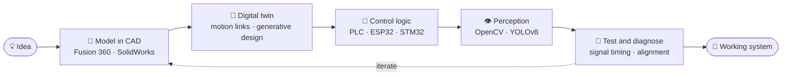
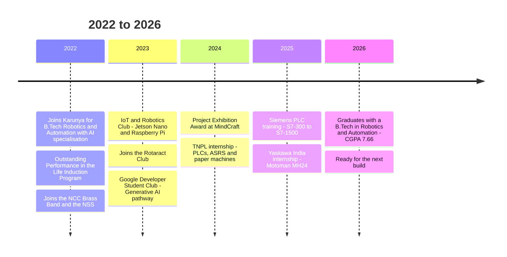

<div align="center">




<br/>


<br/>


<a href="https://arjunrose.github.io/Arjun_Rose_JS/"></a>
<a href="https://www.linkedin.com/in/arjun-rose-j-s"></a>
<a href="mailto:arjunrose2005@gmail.com"></a>
<a href="https://github.com/arjunrose"></a>

<br/><br/>

### Pick your path

<a href="#recruiter"></a>
<a href="#cases"></a>
<a href="#contact"></a>

</div>

<br/>

<a id="recruiter"></a>

## ⚡ The 30-second brief

I work across the whole stack of a machine: the **CAD model**, the **PLC logic**, the **robot cell**, the **camera that has to see**, and the **signal timing that makes it all line up**. B.Tech graduate (2026) in Robotics and Automation with an AI specialisation, two industrial internships, hands-on time with five robot models, and more than twenty projects built from prototype to working hardware.

```text
┌──────────────────────────────────────────────────────────────────┐
│  ARJUN ROSE J S  //  OPERATOR PANEL                  ● ONLINE    │
├──────────────────────────────────────────────────────────────────┤
│  ROLE     Robotics & Automation Engineer (AI specialisation)     │
│  CAMPUS   Karunya Institute of Technology and Sciences           │
│  BATCH    2022 - 2026 · B.Tech Graduate · CGPA 7.66              │
│  CONTROL  Siemens PLC · TIA Portal · Festo MPS · Codesys         │
│  ROBOTS   Yaskawa Motoman · Yaskawa Cobot · Igus Delta · Dobot   │
│  VISION   OpenCV · YOLOv8 · Jetson Nano · Raspberry Pi           │
│  FIELD    Yaskawa India (2025)  ·  TNPL (2024)                   │
│  STATUS   OPEN TO OPPORTUNITIES                                  │
└──────────────────────────────────────────────────────────────────┘
```

<div align="center">


</div>

### 🎯 Hiring for something specific? Start here

| If you need… | Look at | Evidence |
|:--|:--|:--|
| **PLC / Automation Engineer** | Siemens PLC case file · TNPL internship · Siemens training | TIA Portal (Advanced), S7-300 / 400 / 1200 / 1500, HMI faceplates, SCADA, drive control, ASRS and conveyor systems |
| **Robotics / Commissioning Engineer** | Yaskawa India internship | Motoman MH24 (DX200) with ATC and grippers, welding applications, GP8, HC10 cobot, Igus Delta, Dobot Magician |
| **Vision / AI Engineer** | Vision sorting case file · YOLOv8 ID detection · Jetson Nano human detection | Python, OpenCV, custom YOLOv8, Jetson Nano, Raspberry Pi |
| **Embedded / Industrial IoT** | CAN protocol on STM32 + ESP32 · Mimic robotic arm | CAN, ESP32, ESP8266, STM32, real-time servo control |
| **Mechatronics / Design Engineer** | Areca palm robot case file | Fusion 360 generative design, digital twin, SolidWorks, AutoCAD |

<sub>Every row is backed by something in the sections below. Open the case files to see how each one was built.</sub>

<br/>

## 🪜 How I think (in ladder logic)

```text
  L+                                                                  L-
  │                                                                    │
  ├──┤ IDEA ├──┤ CAD + SIM ├──┤ PROTOTYPE ├─────────( WORKING ROBOT )──┤
  │                                                                    │
  ├──┤ SENSOR ├──┤ LOGIC ├──┤ SAFETY ├───────────────────( ACTUATOR )──┤
  │                                                                    │
  ├──┤ PROBLEM ├──┤/ GIVE UP ├─────────────────────────────( SOLVED )──┤
  │                                                                    │
  ├──┤ CURIOSITY ├──┤ HANDS-ON ├─────────────────────( SHIP PROJECT )──┤
  │                                                                    │
```

<sub>Rung 3 uses a normally-closed contact on <b>GIVE UP</b>. It never energises.</sub>

<br/>

## 🏭 Field experience

<details open>
<summary><b>🤖 Yaskawa India Private Limited</b> · Internship, on-site · <i>Jun – Jul 2025</i></summary>

<br/>

- Operated the **Motoman MH24** on the **DX200 controller** with **automatic tool changers** and **grippers**, including welding applications.
- Studied **ATC logic and workflow sequencing** inside PLC-controlled industrial automation, and how robot cells are commissioned in a manufacturing environment.
- Observed **AC drives manufacturing** and **Production Support Software** integration.

`Yaskawa 6-Axis` `DX200` `ATC Logic` `Grippers` `Welding Applications`

</details>

<details>
<summary><b>📰 Tamil Nadu Newsprint and Papers Limited (TNPL)</b> · Internship, on-site · <i>Jun – Jul 2024</i></summary>

<br/>

- Worked hands-on with **PLC systems, ASRS, conveyors, sensors** and **paper machine** operations.
- Studied a large-scale plant automation architecture, analysed how the systems integrate, and learned the control strategies behind **continuous manufacturing**.

`PLCs` `ASRS` `Conveyors` `Industrial Sensors` `Material Handling`

</details>

<details>
<summary><b>🧠 Siemens PLC Training</b> · On-site · <i>Apr 2025</i></summary>

<br/>

- Programmed across **S7-300, S7-400, S7-1200 and S7-1500**.
- Covered **SCADA, drive control, web configuration** and **TIA Portal**.
- Completed the **SIEMENS Certified Training Program on Basic Industrial PLC**.

`TIA Portal` `SCADA` `Drive Control` `S7-1500`

</details>

<details>
<summary><b>🦾 Robotics and Automation Systems lab</b> · Hands-on</summary>

<br/>

- **Industrial automation:** Siemens PLC systems and **FESTO Modular Production Systems (MPS)**.
- **Robots operated:** Yaskawa Motoman **GP8** (YRC1000), Yaskawa Cobot **HC10** (YRC1000), Yaskawa Motoman **MH24** (DX200), **Igus Delta Robot**, **Dobot Magician**.

`Festo MPS` `YRC1000` `Cobots` `Delta Robot`

</details>

<details>
<summary><b>🛰️ IoT and Robotics Club, Karunya</b> · <i>Jan 2023 – Dec 2024</i> &nbsp;|&nbsp; <b>🔵 Google Developer Student Club</b> · <i>Sep 2023 – Present</i></summary>

<br/>

- **IoT and Robotics Club** (Computer Technology Centre): active member, building hands-on IoT and robotics projects on **NVIDIA Jetson Nano** and **Raspberry Pi**.
- **GDSC:** completed the **Google Computing Foundations** and **Generative AI Level 3** pathways, and received Google swag for it.

</details>

<br/>

<a id="cases"></a>

## 🗂️ Case files

Open a file to see what was built, how, and what it proves.

<details>
<summary><b>🏭 Siemens PLC-Based Industrial Automation and Control</b> · <i>ladder logic, HMI, full SDLC</i></summary>

<br/>

| | |
|:--|:--|
| **What I built** | Automated-system control programs for Siemens PLCs in **Ladder Logic** using **TIA Portal**, with **HMI faceplates** for operators. |
| **How** | Configured **I/O modules**, then ran the **software development lifecycle** end to end: technical specifications, build and test processes, to simulate cost-efficient production methods. |
| **Stack** | `Siemens SIMATIC` `TIA Portal` `Ladder Logic` `HMI` `I/O Modules` |
| **What it shows** | I treat PLC work as engineering, with specs and tests, not just rungs that happen to work. |

</details>

<details>
<summary><b>👁️ Vision-Based Industrial Sorting Automation</b> · <i>camera, sensors and pneumatics in one loop</i></summary>

<br/>

| | |
|:--|:--|
| **What I built** | An automated sorting system where **Python and OpenCV** decide, and **sensor-triggered pneumatic actuation** acts. |
| **How** | Ran **diagnostics on signal timing and mechanical alignment** to keep sorting accuracy high. |
| **Stack** | `Python` `OpenCV` `Pneumatics` `Industrial Sensors` |
| **What it shows** | Vision is only half the job. The other half is making the hardware respond at the right instant. |

</details>

<details>
<summary><b>🌴 Areca Palm Tree Climbing and Harvesting Robot</b> · <i>designed and proven in a digital twin</i></summary>

<br/>

| | |
|:--|:--|
| **What I built** | A climbing and harvesting robot designed and simulated in **Autodesk Fusion 360**: **motor enclosures**, **wheel geometry** and a **spring-based gripper**. |
| **How** | Used **generative design** and **motion links** as a **digital twin** to validate the physical mechanics before building. |
| **Stack** | `Fusion 360` `Generative Design` `Digital Twin` `ESP32` |
| **What it shows** | I validate the mechanics virtually first, which saves hardware iterations. |

</details>

<details>
<summary><b>🦾 Mimic Robotic Arm with Real-Time Control</b> · <i>sensor in, servo motion out, no lag</i></summary>

<br/>

| | |
|:--|:--|
| **What I built** | A microcontroller-based robotic arm with **real-time servo actuation** driven by sensor input. |
| **How** | Implemented the **control logic and signal processing** so the motion stays **synchronised and stable**. |
| **Stack** | `Microcontrollers` `Servos` `Sensors` `Signal Processing` |
| **What it shows** | Smooth real-time control, not just moving a servo. |

</details>

<br/>

### 📦 Every project, indexed

| Domain | Projects |
|:--|:--|
| 🏭 **Industrial and PLC** | Siemens PLC-Based Industrial Automation and Control · Vision-Based Industrial Sorting Automation |
| 🤖 **Robotics** | Areca Palm Climbing and Harvesting Robot · Humanoid Robot · Mimic Robotic Arm · Kinematic Analysis of Dobot Magician · Autonomous 2D Mapping Robot (MATLAB and DFS algorithm) · Autonomous Floor Drawing Robot · Light Tracking Robot · Obstacle Avoidance Robot · Line Follower Robot · Bluetooth Controlled Grass Cutting Robot |
| 👁️ **Vision and AI** | Student ID Card Detection and Management (custom YOLOv8) · Human Detection in Disaster Areas (Jetson Nano) · Face Detection System (Raspberry Pi 4) |
| 🔌 **Embedded and IoT** | CAN Protocol using STM32 and ESP32 · Smart Plant Monitoring System · Wireless PC Cursor Control using Head Movements · DTMF Based Home Automation System · Digital Level Scale |
| ⚙️ **Mechanical** | Steam Engine Prototype Demonstration |

<br/>

<a id="arsenal"></a>

## 🧰 Tech arsenal

<div align="center">


</div>

<br/>

**Automation and control**


**Robots and hardware**


**CAD and engineering software**


<br/>

**How strong, honestly**

| Level | Skills |
|:--|:--|
| `██████████` **Advanced** | PLC programming · Siemens TIA Portal · Arduino IDE |
| `███████░░░` **Intermediate** | Python · Computer Vision · Robotics · Hydraulics and Pneumatics · Fusion 360 · SolidWorks · AutoCAD · Keil uVision · Git and GitHub · Linux · Windows · Arduino · Raspberry Pi · NVIDIA Jetson Nano · ESP32 · ESP8266 |
| `████░░░░░░` **Basic** | C · C++ · MATLAB · LabVIEW · LaTeX · HTML · Thonny IDE · STM32F407 |

**People skills:** Leadership · Team Collaboration · Project Management · Problem-Solving · Time Management

<br/>

## 🔁 How I build



<br/>

<a id="journey"></a>

## 🗺️ Mission log



<br/>

## 📜 Certifications and courses

| Domain | Credentials |
|:--|:--|
| 🏭 **Industrial** | SIEMENS Certified Training Program on Basic Industrial PLC · NPTEL: Introduction to Industry 4.0 and Industrial IoT |
| 🤖 **AI and vision** | NVIDIA: Getting Started with AI on Jetson Nano · AWS DeepRacer: Driven by Reinforcement Learning · AI For India 2.0 Program (GUVI) |
| ☁️ **Cloud and security** | Google Cybersecurity Professional Certificate · Microsoft Azure Fundamentals · CISCO: Network Addressing and Basic Troubleshooting |
| 🧰 **Software and tools** | Python (Kaggle, Simplilearn, GUVI) · Linux Tutorial (Great Learning Academy) · MATLAB Onramp (MathWorks) · Autodesk Fusion 360 · Problem Solving Using Computational Thinking (Coursera) |
| 🎤 **Communication** | NPTEL: Speaking Effectively |

<br/>

## 🏆 Recognition and life beyond the code

| | |
|:--|:--|
| 🏆 **Project Exhibition Award** | MindCraft, Karunya · Feb 2024 |
| 🌟 **Outstanding Performance** | Life Induction Program, Karunya · Aug 2022 |
| 🎺 **NCC Brass Band** | Euphonium player, performed for Republic Day and Independence Day · Aug 2022 – Present |
| 🤝 **Rotaract Club** | Community service activities · Aug 2023 – Jun 2024 |
| 🌱 **National Service Scheme** | Social service activities · Aug 2022 – Jun 2023 |

<details>
<summary>🔓 <b>Unlock the hidden rung</b></summary>

<br/>

I program ladder logic and I play the euphonium. Both come down to the same thing: **the right thing, at the right moment, in the right order.** A PLC scan cycle and a brass band reward exactly the same discipline.

</details>

<br/>

<a id="contact"></a>

## 🤝 Let's build something

If you have a line that needs automating, a robot that needs a brain, or a camera that needs to understand what it sees, I would like to hear about it.

<div align="center">

<a href="mailto:arjunrose2005@gmail.com"></a>
<a href="https://www.linkedin.com/in/arjun-rose-j-s"></a>
<a href="https://arjunrose.github.io/Arjun_Rose_JS/"></a>

</div>

<br/>

## 📊 GitHub pulse

<div align="center">


<br/>



</div>
