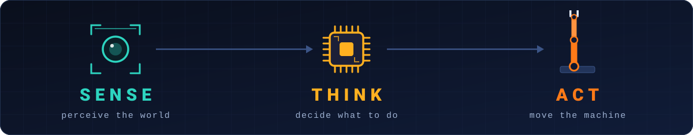
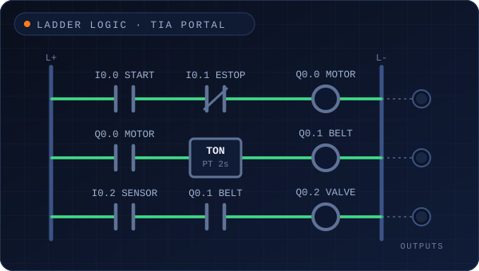
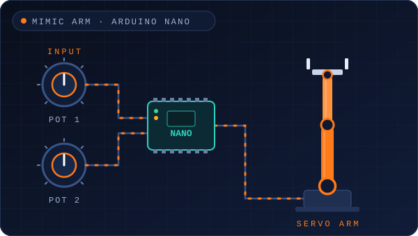
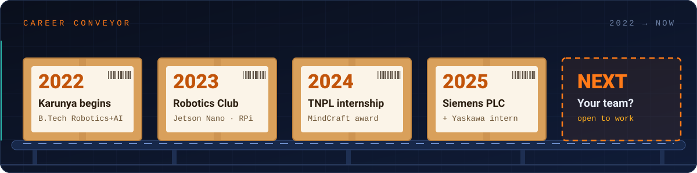

<!--
  ┌──────────────────────────────────────────────────────────────┐
  │  You're reading the source. Respect.                         │
  │  Engineers who check the source get a direct line:           │
  │  arjunrose2005@gmail.com  ·  subject: "I read the source"    │
  └──────────────────────────────────────────────────────────────┘
-->

<div align="center">


<br>

<a href="mailto:arjunrose2005@gmail.com?subject=Opportunity%20for%20Arjun%20Rose%20J%20S"></a>
<a href="https://www.linkedin.com/in/arjun-rose-j-s"></a>
<a href="https://arjunrose.github.io/Arjun_Rose_J_S/"></a>

<sub><a href="#the-loop">The loop</a> &nbsp;·&nbsp; <a href="#build-bay">Build bay</a> &nbsp;·&nbsp; <a href="#real-machines">Real machines</a> &nbsp;·&nbsp; <a href="#puzzle">Puzzle</a> &nbsp;·&nbsp; <a href="#skills">Skills</a> &nbsp;·&nbsp; <a href="#contact">Contact</a></sub>

<sub>⚙️ <b>5 gears are hidden on this page.</b> Tap the little ▸ arrows to find them all.</sub>

</div>

<br>


### 👋 Hi, I'm Arjun

I build machines that **sense, think and move**. I'm as comfortable in a **Siemens PLC cabinet** as I am in a **YOLOv8 notebook**: I've operated **Yaskawa** robots on the shop floor, programmed **S7 PLCs in TIA Portal**, worked with **Festo Modular Production Systems**, and built **20+ projects**, from a humanoid that waves hello to a robot that maps its own surroundings.

- 🎓 **B.Tech Robotics & Automation** (AI specialisation) · Karunya Institute of Technology and Sciences, Coimbatore · 2022 – 2026
- 🏭 **On-site internships** at **Yaskawa India** and **Tamil Nadu Newsprint & Papers Ltd (TNPL)**
- 🎯 **Looking for** Automation · PLC / Controls · Robotics · Vision-AI roles (graduate engineer or trainee)
- 📍 Tamil Nadu, India

<br clear="right">

<details><summary>⚙️</summary><b>Gear 1 / 5 → “NO”</b> &nbsp;<sub>(four more are hiding)</sub></details>

<br>

<a name="the-loop"></a>

## 🔁 Everything I build is one loop



<table>
<tr>
<td width="33%" valign="top">

**👁️ SENSE**

**Vision** · OpenCV, YOLOv8 (custom-trained)<br>
**Edge computers** · NVIDIA Jetson Nano, Raspberry Pi 4<br>
**Sensors** · IR, ultrasonic, LDR, IMU (accelerometer + gyro), temperature, humidity, soil moisture

</td>
<td width="33%" valign="top">

**🧠 THINK**

**PLC** · Siemens S7-300 / 400 / 1200 / 1500, TIA Portal, Ladder Logic, SCADA, HMI faceplates<br>
**Code** · Python, MATLAB, C / C++<br>
**Algorithms** · DFS exploration & mapping, control logic, signal processing

</td>
<td width="33%" valign="top">

**🦾 ACT**

**Industrial robots** · Yaskawa Motoman MH24 (DX200), GP8 (YRC1000), HC10 cobot (YRC1000)<br>
**Lab robots** · Igus Delta, Dobot Magician<br>
**Actuation** · Festo MPS, pneumatics & hydraulics, servos, motors

</td>
</tr>
</table>

<sub>➕ **Also in the toolbox:** 📐 Fusion 360 · SolidWorks · AutoCAD (CAD and digital twins) &nbsp;·&nbsp; 🔗 CAN · ESP32 / ESP8266 · STM32 · Arduino &nbsp;·&nbsp; 🧰 Git · Linux · Keil µVision · LabVIEW · CODESYS</sub>

<details><summary>⚙️</summary><b>Gear 2 / 5 → “PROBLEM”</b></details>

<br>

<a name="build-bay"></a>

## 🛠️ The build bay

Six builds as animated sketches: just watch, they loop. *(The maze one is worth the full cycle.)*

<table>
<tr>
<td width="50%" valign="top">



**🏭 Siemens PLC automation & control**<br>
Ladder logic in TIA Portal with HMI faceplates. Configured I/O modules and followed SDLC phases (specs, build, test) to simulate cost-efficient production.<br>
<code>Siemens S7</code> <code>TIA Portal</code> <code>Ladder Logic</code> <code>HMI</code>

</td>
<td width="50%" valign="top">



**🛟 People detection in disaster areas**<br>
A Jetson Nano system that identifies and locates people in disaster zones to support search and rescue. [▶ Watch the demo](https://drive.google.com/file/d/1bJ2ayV-f-17Kjy0WE5mmYVIoKassF4zj/view?usp=sharing)<br>
<code>Jetson Nano</code> <code>Computer Vision</code>

</td>
</tr>
<tr>
<td width="50%" valign="top">



**🗺️ Autonomous 2D mapping robot**<br>
An ESP32 robot that explores and maps its surroundings on its own, driven by a depth-first-search algorithm with MATLAB.<br>
<code>ESP32</code> <code>MATLAB</code> <code>DFS</code>

</td>
<td width="50%" valign="top">



**🌴 Areca palm climbing & harvesting robot**<br>
Designed and simulated in Fusion 360: motor enclosures, wheel geometry and a spring-based gripper, validated as a digital twin with generative design and motion links.<br>
<code>Fusion 360</code> <code>Digital twin</code> <code>Generative design</code>

</td>
</tr>
<tr>
<td width="50%" valign="top">



**🦾 Mimic robotic arm**<br>
Custom PCB, Arduino Nano, potentiometers and servo motors: move the input and the arm follows in real time. [▶ See it in action](https://www.linkedin.com/posts/arjun-rose-j-s-957761252_robotics-innovation-creativity-activity-7156193146060627968-X0dx)<br>
<code>Arduino Nano</code> <code>Servos</code> <code>Custom PCB</code>

</td>
<td width="50%" valign="top">



**🔗 CAN bus: STM32 + ESP32**<br>
Controller Area Network communication between STM32 and ESP32 microcontrollers.<br>
<code>CAN</code> <code>STM32</code> <code>ESP32</code>

</td>
</tr>
</table>

<sub>🎞️ The tiles are animated sketches of each build, not footage. The ▶ links go to real demos wherever I have them.</sub>

<details>
<summary><b>🧰 16 more builds</b>: industrial vision, a humanoid, IoT, and a fleet of robots that follow, avoid and cut things</summary>

<br>

| Build | What it is | Proof |
|:--|:--|:--|
| **Vision-based industrial sorting** | Python + OpenCV vision with sensor-triggered pneumatic actuation; diagnosed signal timing and mechanical alignment to keep accuracy high | — |
| **Humanoid robot** *(team build)* | Waves hello and shakes hands. Arduino Mega + Uno, servo motors, RGB-light eyes, 3D-printed parts | [▶ Post](https://www.linkedin.com/posts/thanmai-sri-murali-chilukuri-847902245_humanoidrobotics-innovation-teamwork-ugcPost-7187725732628914176-2sx6) |
| **Student ID card detection & management** | Custom-trained YOLOv8 model | — |
| **Face detection on Raspberry Pi 4** | A Raspberry Pi 4-based face detection system | — |
| **Real-time face filters** | Snapchat-style live effects applied to faces from a camera feed, in Python | — |
| **Smart plant monitoring** | ESP8266 senses temperature, humidity, soil moisture and motion, waters plants automatically and streams live data to a phone | [▶ Post](https://www.linkedin.com/posts/arjun-rose-j-s-957761252_smartplantmonitoring-iot-innovation-activity-7060444627635474432-qKFD) |
| **Wireless PC cursor control** | Head-movement tracking moves the cursor wirelessly over ESP8266 | — |
| **Autonomous floor-drawing robot** | ESP32 robot that draws patterns on the floor on its own | — |
| **Kinematic analysis of Dobot Magician** | Kinematic study of the Dobot Magician arm | — |
| **Digital level scale** | Arduino Nano + accelerometer + gyro measure and display angular displacement | [▶ Demo](https://drive.google.com/file/d/17oga-yYOfC1ABf4sgYrUZvbzkFQ-x1N1/view?usp=sharing) |
| **Steam engine prototype** | Shows how steam pressure is converted into mechanical motion | [▶ Demo](https://drive.google.com/file/d/1hfoZ7GR35n5Lncd9GA2tDQ8KOudqCg5Y/view?usp=sharing) |
| **Light-tracking robot** | Arduino + LDRs + motor driver: follows a light source on its own | [▶ Post](https://www.linkedin.com/posts/arjun-rose-j-s-957761252_robotics-diyproject-techinnovation-activity-7060444279411781633-yVBr) |
| **DTMF home automation** | Switch home appliances remotely with phone DTMF tones | [▶ Demo](https://drive.google.com/file/d/1K0VllZ2XMuI9ptg5KY0CkJGE8X6LxmAg/view?usp=sharing) |
| **Bluetooth grass-cutting robot** | Arduino Uno + Bluetooth module, driven from a phone | [▶ Demo](https://drive.google.com/file/d/1C92GQGJKlCLjdLGNP5erLyb3VA_ZLZ1g/view?usp=sharing) |
| **Obstacle-avoidance robot** | Ultrasonic sensor + motor driver, built on Arduino Uno and on Raspberry Pi | [▶ Uno](https://drive.google.com/file/d/11_t5lJtTeCnqhBLzXP_0wCNCXC19uY3v/view?usp=sharing) · [▶ Pi](https://drive.google.com/file/d/1_nOzRFVuFY83WD_LH6B360dMZoYP5LBv/view?usp=sharing) |
| **Line-follower robot** | IR sensors + Arduino Uno follow a path autonomously | — |

</details>

<details><summary>⚙️</summary><b>Gear 3 / 5 → “STAYS”</b></details>

<br>

<a name="real-machines"></a>

## 🏭 Real machines, real plants



| When | Where | What I got my hands on |
|:--|:--|:--|
| **Jun – Jul 2025** | **Yaskawa India Pvt. Ltd.**, Bengaluru<br><sub>on-site intern</sub> | Operated the Motoman **MH24 (DX200)** with automatic tool changers and grippers, including welding applications · studied ATC logic, workflow sequencing and robot commissioning practice · observed AC-drive manufacturing and Production Support Software integration |
| **Apr 2025** | **Siemens PLC training**<br><sub>on-site</sub> | **S7-300 / 400 / 1200 / 1500** · programming · SCADA · drive control · web configuration · **TIA Portal** |
| **Jun – Jul 2024** | **Tamil Nadu Newsprint & Papers Ltd (TNPL)**, Karur<br><sub>on-site intern</sub> | PLC systems · **ASRS** · conveyors · sensors · paper-machine operations · plant automation architecture and system integration in continuous manufacturing |
| **Robotics lab** | **Robotics & automation systems**<br><sub>on-site</sub> | Hands-on with **Yaskawa Motoman GP8** and **HC10 cobot** (YRC1000), **MH24** (DX200), **Igus Delta** and **Dobot Magician**, plus **Siemens PLC** and **Festo MPS** stations · 🎥 GP8 clips: [one](https://drive.google.com/file/d/1K7wAblHgrRcNoFg5ZcKFD95u9_cd13QL/view?usp=sharing) · [two](https://drive.google.com/file/d/1zm7nWeiCtxIKrYvjnI4upKB4ruWC-WiE/view?usp=sharing) |
| **Jan 2023 – Dec 2024** | **IoT & Robotics Club**, Karunya | Hands-on projects with **NVIDIA Jetson Nano** and **Raspberry Pi** |
| **Sep 2023 – present** | **Google Developer Student Club** | Completed the **Google Computing Foundations** and **Generative AI (Level 3)** pathways |

<br>

<a name="puzzle"></a>

## 🧩 30-second PLC puzzle

*Think like a controls engineer.* This motor **never starts**. Why?

```
 L1 ┃                                                        ┃ L2
    ┃          I0.0              I0.1              Q0.0      ┃
    ┣━━━━━━━━━━━┫ ┣━━━━━━━━━━━━━━━┫/┣━━━━━━━━━━━━━━━( )━━━━━━┫
    ┃          START             STOP              MOTOR     ┃
```

`START` is a normal pushbutton on `I0.0`. `STOP` is a **normally-closed** pushbutton wired to `I0.1`. You press START and nothing happens. *(Seal-in left out to keep it short.)*

<details>
<summary><b>Show the answer</b></summary>

<br>

A field-wired **NC** button holds `I0.1` **TRUE** while it's released. An **NC contact** in the program (examine-for-0) only passes power while its input is **FALSE**, so with STOP released the rung is open and START can never start the motor. The logic is inverted: it would only run while you *hold* STOP. Classic double negation.

**Fix:** use a **NO contact** (examine-for-1) for a field-wired NC stop. Bonus: a broken wire now drops the input, opens the rung and stops the motor, which is exactly the fail-safe behaviour you want.

</details>

<br>

<a name="skills"></a>

## 🎚️ Skills, with honest levels

<sub>Straight from my CV: no inflated progress bars.</sub>

<table>
<tr>
<th width="33%" align="left">🟢 Advanced</th>
<th width="34%" align="left">🟡 Intermediate</th>
<th width="33%" align="left">🔵 Foundations</th>
</tr>
<tr>
<td valign="top">

PLC programming<br>
Siemens TIA Portal<br>
Festo MPS<br>
Arduino IDE

</td>
<td valign="top">

Python · Robotics · Computer vision<br>
Pneumatics & hydraulics<br>
Fusion 360 · SolidWorks · AutoCAD<br>
Keil µVision<br>
Git / GitHub · Linux · Windows<br>
Raspberry Pi · Jetson Nano<br>
ESP32 · ESP8266 · Arduino boards

</td>
<td valign="top">

C · C++<br>
MATLAB<br>
STM32<br>
LabVIEW<br>
LaTeX · HTML<br>
Thonny

</td>
</tr>
</table>

<details><summary>⚙️</summary><b>Gear 4 / 5 → “MANUAL”</b></details>

<br>

## 🏆 Recognition & life beyond the lab

<table>
<tr>
<td width="50%" valign="top">

**🏆 Recognition**

- 🥇 **Project Exhibition Award**, MindCraft, Karunya · Feb 2024
- 🌟 **Outstanding Performance**, Life Induction Program, Karunya · Aug 2022
- 🎁 **Google Developer Student Club**: finished the Google Computing Foundations and Generative AI (Level 3) pathways and earned Google swag

</td>
<td width="50%" valign="top">

**🎺 Beyond the lab**

- **Euphonium player**, NCC Brass Band, Karunya: performed at Republic Day and Independence Day celebrations · Aug 2022 – present
- **Rotaract Club**: community service · Aug 2023 – Jun 2024
- **National Service Scheme**: social service · Aug 2022 – Jun 2023
- **Nature Club**: environmental awareness · 2024 – present

</td>
</tr>
</table>

<sub>🤝 Soft skills: leadership · team collaboration · project management · problem-solving · time management</sub>

<details>
<summary><b>📜 15+ certifications & courses</b>: Siemens, NVIDIA, Google, Microsoft, AWS, NPTEL… (tap to expand)</summary>

<br>

| Area | Certifications & courses |
|:--|:--|
| **Industrial & automation** | SIEMENS Certified Training Program on Basic Industrial PLC · Introduction to Industry 4.0 and Industrial IoT (NPTEL) · Robotic Process Automation (IBM) |
| **AI & vision** | Getting Started with AI on Jetson Nano (NVIDIA) · AWS DeepRacer: Driven by Reinforcement Learning · AI For India 2.0 (GUVI) · ChatGPT Prompt Engineering (Coursera) · MATLAB Onramp (MathWorks) |
| **Cloud & security** | Microsoft Azure Fundamentals · Google Cybersecurity Professional Certificate · Google Cloud Jam 2023 · Hacking and Patching (Google) · Network Addressing and Basic Troubleshooting (Cisco) |
| **Software & design** | Python (Kaggle, Simplilearn, GUVI) · Linux Tutorial (Great Learning Academy) · Autodesk Fusion 360 · Problem Solving Using Computational Thinking (Coursera) · Innovation Through Design: Think, Make, Break, Repeat (Coursera) |
| **Communication** | Speaking Effectively (NPTEL) |

</details>

<br>

<a name="contact"></a>

<div align="center">


<br>

<a href="mailto:arjunrose2005@gmail.com?subject=Opportunity%20for%20Arjun%20Rose%20J%20S"></a>
<a href="https://www.linkedin.com/in/arjun-rose-j-s"></a>
<a href="https://arjunrose.github.io/Arjun_Rose_J_S/"></a>

<sub>If you scrolled this far, you already think like an automation engineer: you don't stop until the loop closes. 🙂</sub>

<details><summary>⚙️</summary><b>Gear 5 / 5 → “FOREVER”</b><br><br>All five found. The message: <b>“No problem stays manual forever.”</b><br>If that's how you think too, email me with the subject line <code>MANUAL</code>. I'll know you read every pixel.</details>

</div>
